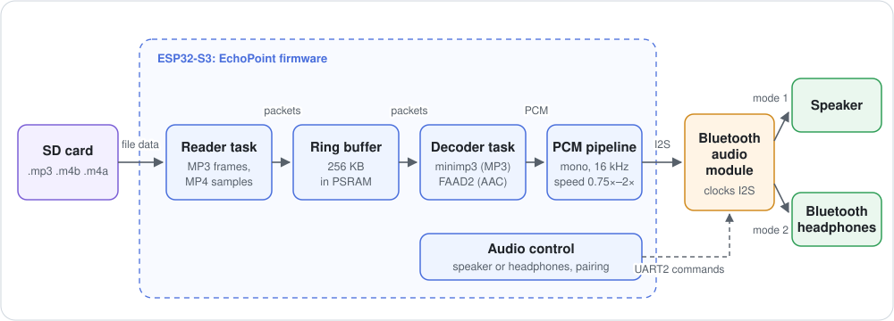

<h1 align="center"></h1>

Read and listen on the Metalio E-Ink 4: the CrossPoint e-book reader, plus an
audiobook player for the built-in speaker and Bluetooth headphones.

[](https://github.com/hva-org/echopoint/releases)
[](https://github.com/hva-org/echopoint/actions/workflows/ci.yml?query=branch%3Adevelop)
[](licenses/README.md)

EchoPoint is an unofficial fork of
[CrossPoint Reader](https://github.com/crosspoint-reader/crosspoint-reader),
the open-source e-reader firmware. It is built on the
[FreeInk SDK](https://github.com/Free-Ink/freeink-sdk) and runs on one device:
the **Metalio E-Ink 4** (ESP32-S3, 16 MB flash, 8 MB PSRAM).

CrossPoint focuses on reading and leaves other features to forks
(see [SCOPE.md](SCOPE.md)). Audio playback is outside that focus, so EchoPoint
adds it for the Metalio E-Ink 4 and keeps the rest of CrossPoint.

EchoPoint is not affiliated with CrossPoint, Xteink or Metalio.
The menus on the device still say "CrossPoint".

> [!WARNING]
> The first release, **2.0.0-echo.1**, is a pre-release. It has not been
> tested on hardware yet.

## What EchoPoint adds

- **Audiobook player** for `.mp3`, `.m4b` and `.m4a` files (MP3, AAC-LC and
  HE-AAC; mono or stereo).
  - A folder of MP3 files is one book. Its files play in name order, with
    numbers sorted by value ("Part 2" before "Part 10"), and each file is a
    chapter. An M4B or M4A file uses the chapters stored in it.
  - Play and pause, 30-second skips, previous and next chapter, a chapter
    list, and a slider to move within the current chapter.
  - Speed from 0.75× to 2× in steps of 0.25×, without changing the pitch.
  - Volume slider and the device's volume keys.
  - Each book remembers its position.
  - The book keeps playing while you read or browse. The device stays awake
    while a book plays. After three hours without input, the book pauses so
    the device can sleep.
- **Speaker output** through the board's audio module.
- **Bluetooth headphones**: scan, pick and save a pair, then switch between the
  speaker and the headphones from the control center or the Bluetooth
  Headphones screen. The output button in the player opens that screen.
- **Control center card**: swipe down from the top edge to see the book and
  chapter, play or pause, skip, move in the chapter, change the volume and
  switch the output.
- **Power button**: set a short click or a double click to play or pause the
  open book from any screen.

Audio goes out as 16 kHz mono, which suits speech more than music.
Which headphones work depends on the board's Bluetooth audio module.

### How the audio gets out



The speaker and the headphones both go through the board's Bluetooth audio
module. EchoPoint sends it commands over UART2 to choose the output and to
pair headphones, and streams the audio to it over I2S.

## Everything from CrossPoint

EchoPoint keeps the CrossPoint reader. On the Metalio E-Ink 4 this includes:

- **Reader engine**: EPUB 2/3 with images, hyphenation, kerning, tables, CJK
  ruby, footnotes, bookmarks, go-to-percent, auto page turn, orientation and
  focus reading. It also opens `.xtc`/`.xtch`, `.txt` and `.bmp` files.
- **Touch**: follow links, look up words in a
  [StarDict dictionary](docs/dictionary.md), highlight text and save clippings.
- **Custom fonts** from the SD card (see [SD card fonts](docs/sd-card-fonts.md)).
- **Library**: title and author search, recent and alphabetical views, and a
  folder browser.
- **Wireless**: file transfer web page, WebDAV, Calibre wireless, OPDS
  catalogs, settings in the browser, and KOReader progress sync.
- **USB Drive mode** for the SD card, and **Bluetooth page turners**.
- **Customization**: themes, sleep screens, button mapping, more than 30 UI
  languages, and [SD card plugins](docs/sd-plugins.md).

The [CrossPoint project](https://github.com/crosspoint-reader/crosspoint-reader#readme)
has the full feature list. The [User Guide](USER_GUIDE.md) explains how to use
them.

## Install

Download the firmware from
[Releases](https://github.com/hva-org/echopoint/releases). Each release has
one firmware file, `echopoint-<version>-metalio_eink4.bin` (for example
`echopoint-2.0.0-echo.1-metalio_eink4.bin`), and a `LICENSE` file.

**If the device already runs EchoPoint or CrossPoint** (a version with
**SD Card Firmware Update**):

1. Copy the `.bin` file to the SD card.
2. On the device, open **Settings → System → SD Card Firmware Update** and
   pick the file.
3. Keep the device powered until it restarts.

The update refuses CrossPoint or EchoPoint firmware that was built for a
different device.

**Updates over Wi-Fi**: **Settings → System → Check for Updates** installs
the newest full release from this repository. It does not offer pre-releases;
install those from the SD card. Until the first full release exists, the
check reports a failure instead of "no update".

**First install from the stock Metalio firmware**: there is no web installer.
Build the release and flash it over USB with PlatformIO; see
[Build from source](#build-from-source). This repository does not document a
way back to the stock firmware.

## Using audiobooks

1. Copy your books to the SD card, for example with USB Drive mode or the file
   transfer web page. Give each MP3 book its own folder. An M4B or M4A file is
   a book on its own, wherever it is.
2. Open **Browse Files** and select a book file. The player opens and starts
   playing. A book you played before continues where it stopped.
3. In the player, the large round button plays or pauses. **Confirm** also
   plays or pauses, and **Up**/**Down** change the volume. **Back** leaves the
   player; the book keeps playing.
4. To use headphones, open **Settings → Connectivity → Bluetooth Headphones**
   and choose **Scan for Headphones**. Select your headphones; once they
   connect, they are saved and become the output.
5. To go back to the speaker, tap the output button in the control center, or
   select **Audio Output** in the Bluetooth Headphones screen.

See [Audiobooks in the User Guide](USER_GUIDE.md#39-audiobooks-echopoint) for
the details.

## Build from source

Set up the toolchain first; see
[Getting Started](docs/contributing/getting-started.md). Then build a release
and flash it over USB (replace `2.0.0-echo.1` with the release you want):

```sh
git clone --recursive https://github.com/hva-org/echopoint.git
cd echopoint
git checkout 2.0.0-echo.1
git submodule update --init --recursive
pio run -e metalio_eink4-audiobook-gh_release -t upload
```

This gives the same firmware as the release file, so **Check for Updates**
offers the next full release. For development, build
`metalio_eink4-audiobook` instead: it adds debug logging and reports a
`-dev-<branch>-<sha>` version.

## Releases

How a release is made:

1. Set the version in `platformio.ini`, section `[crosspoint]`. The format is
   `<upstream version>-echo.<n>`, for example `2.0.0-echo.1` (CrossPoint
   2.0.0, EchoPoint build 1).
2. Publish a GitHub release whose tag is exactly that version, without a `v`.
   Mark untested builds as pre-releases.
3. The [release workflow](.github/workflows/release.yml) builds the firmware
   and attaches `echopoint-<version>-metalio_eink4.bin` and `LICENSE` to the
   release.

Check for Updates on the device only sees full releases, so a pre-release
reaches only people who install it themselves.

## License

- CrossPoint's original code uses the MIT license in [LICENSE](LICENSE).
- The combined firmware is GPLv3, because it includes wolfSSL.
- The audiobook player uses [minimp3](https://github.com/lieff/minimp3)
  (CC0-1.0), [FAAD2](https://github.com/knik0/faad2) (GPL-2.0-or-later) and
  [Sonic](https://github.com/waywardgeek/sonic) (Apache-2.0).

[licenses/README.md](licenses/README.md) lists all third-party code and
explains how to get the source for a release.

## Credits

- The [CrossPoint Reader](https://github.com/crosspoint-reader/crosspoint-reader)
  contributors, who wrote the reader that EchoPoint is built on. CrossPoint
  funds its contributors through
  [royalty.dev](https://app.royalty.dev/crosspoint-reader/crosspoint-reader).
- The [FreeInk SDK](https://github.com/Free-Ink/freeink-sdk), for the Metalio
  E-Ink 4 board support and shared UI.
- [minimp3](https://github.com/lieff/minimp3) by lieff (MP3 decoding).
- [FAAD2](https://github.com/knik0/faad2) (AAC decoding). Code from FAAD2 is
  copyright (c) Nero AG, www.nero.com.
- [Sonic](https://github.com/waywardgeek/sonic) by Bill Cox (speed change
  without pitch change).
